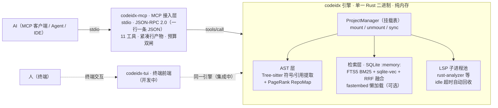

# codeidx

全局按需挂载的代码索引引擎 —— 单一 Rust 原生二进制，零 Python/Node 运行时依赖。

## 双表面：MCP 给 AI，前端给人

**MCP 是给 AI 用的，前端是给人用的。** codeidx 用同一个引擎同时服务两类用户：

| 表面 | 用户 | 形态 | 状态 |
|---|---|---|---|
| `codeidx-mcp` | AI（Agent / IDE） | stdio MCP 服务：11 个工具、紧凑行产物、token 预算双闸 | 已交付，黑盒验收全绿 |
| `codeidx-tui` | 人 | 原生终端前端 | 开发中 |

- **同一引擎**：AST 骨架 + FTS5/向量混合检索 + LSP 桥；纯内存、按需挂载、`unmount_project` 即释放。
- **命名**：仓库为 **codeidx**；`codeidx-mcp` 是 workspace 内 MCP 接入层 crate 的准确命名（与在途的 `codeidx-tui` 对应）。

## 核心特性

- **全局轻量常驻**：启动时零扫描、零模型、零 LSP，空闲实测 VmRSS 10.3MB（见[性能实测](#性能与资源实测)）
- **按需挂载**：仅当 AI 调用 `mount_project(path)` 时才在内存中初始化索引
- **纯内存态**：AST 符号表 / 依赖图 / FTS5 / 向量索引全部在 SQLite `:memory:`，不在项目目录残留缓存
- **三层能力**：
  1. AST 骨架（Tree-sitter + PageRank RepoMap）
  2. 混合检索（FTS5 BM25 + sqlite-vec 向量 + RRF 融合，fastembed 懒加载可选）
  3. 按需 LSP 桥（rust-analyzer 等，idle timeout 自动回收）
- **即时释放**：`unmount_project` 销毁内存库并 kill 关联 LSP；SIGINT/SIGTERM 优雅清理

## 文档

- 架构契约：[ARCHITECTURE.md](ARCHITECTURE.md)
- 验收线路：[docs/ACCEPTANCE.md](docs/ACCEPTANCE.md)
- 验收记录：[docs/acceptance-log.md](docs/acceptance-log.md)
- Agent 渐进式披露 SOP：[docs/AGENT-SOP.md](docs/AGENT-SOP.md)

## Quick Start

前置：Rust 稳定版工具链（[rustup](https://rustup.rs/)）。

```bash
git clone https://github.com/Thatgfsj/codeidx.git
cd codeidx
cargo build --release --bin codeidx-mcp
```

产物为单文件原生二进制 `target/release/codeidx-mcp`：

- 运行期零 Python / Node.js 依赖；SQLite（bundled，FTS5 内嵌编译）与 sqlite-vec 均静态链接，不依赖系统库。
- 可选向量检索的 embedding 模型（fastembed，BAAI/bge-small-zh-v1.5）仅在首次以 `enable_vector=true` 挂载时懒加载；缓存目录 `~/.cache/codeidx-mcp`（约 91MB），缓存命中免联网，首次无缓存需下载 90.5MB。

stdio 冒烟（一行一条 JSON，肉眼即可验证 stdout 纯净性）：

```bash
target/release/codeidx-mcp <<'EOF'
{"jsonrpc":"2.0","id":1,"method":"initialize","params":{"protocolVersion":"2024-11-05","capabilities":{},"clientInfo":{"name":"smoke","version":"0"}}}
{"jsonrpc":"2.0","method":"notifications/initialized"}
{"jsonrpc":"2.0","id":2,"method":"tools/list"}
EOF
```

`tools/list` 应返回 11 个工具。

### 跑测试与黑盒

通用门（与 CI 同一套，见 [docs/ACCEPTANCE.md](docs/ACCEPTANCE.md) §0）：

```bash
cargo fmt --check
cargo clippy --workspace --all-targets -- -D warnings
cargo test --workspace
```

黑盒验收（stdio 驱动，逐行解析 stdout 并断言零污染）：

```bash
node scripts/bb_phase1.mjs ./target/release/codeidx-mcp
node scripts/bb_phase2.mjs ./target/release/codeidx-mcp  # 前提：模型缓存 ~/.cache/codeidx-mcp，首跑触发下载
node scripts/bb_phase3.mjs ./target/release/codeidx-mcp
```

## 给 AI 的表面：stdio MCP 服务

### MCP 客户端接入

codeidx-mcp 走 stdio 上的 JSON-RPC 2.0，可被任意 MCP 客户端（AI Agent / IDE）作为 stdio server 挂起：

- **一行一条 JSON 消息**（不使用 LSP 式 `Content-Length` 头）
- **stdout 仅输出 JSON-RPC 协议字节**；一切日志 / tracing 走 stderr，客户端可放心把 stdout 逐行 `JSON.parse`
- 工具执行失败不走协议层错误：`tools/call` 返回 `result.isError = true` 与 `content[0].text = "error: <原因>"`（`-32601` 这类仅保留给 method not found 等协议级错误）
- 握手协议版本：`initialize` 宣告 `protocolVersion` = `2024-11-05`

通用 JSON-RPC over stdio 客户端配置片段：

```json
{
  "mcpServers": {
    "codeidx": {
      "command": "/absolute/path/to/target/release/codeidx-mcp",
      "args": [],
      "env": {
        "RUST_LOG": "info",
        "CODEIDX_LSP_IDLE_SECS": "300"
      }
    }
  }
}
```

服务端不读任何命令行参数，全部运行期开关通过环境变量注入（见[环境变量](#环境变量)）。

`tools/call` 请求样例（`params.name` 为工具名，`params.arguments` 为蛇形参数）：

```json
{"jsonrpc":"2.0","id":3,"method":"tools/call","params":{"name":"mount_project","arguments":{"path":"/absolute/project/root"}}}
```

### 11 工具速查

参数名一律蛇形（snake_case）。除 `list_mounted_projects` 外，均要求 `path`（已挂载项目的根目录绝对路径）；`line` 一律 1-based、`character` 一律 0-based（UTF-16 code unit，与 LSP 对齐）。

| 工具 | 关键参数 | 一句话用途 |
|---|---|---|
| `mount_project` | `path`；`enable_vector?`（bool，默认 false） | 挂载项目并在内存中构建索引；返回 `skipped_binary/skipped_oversize/skipped_unsupported` 三类跳过计数与 `vector_degraded/vector_degraded_reason` 降级标记 |
| `unmount_project` | `path` | 卸载项目：销毁内存索引并回收关联的 LSP 子进程 |
| `list_mounted_projects` | — | 列出当前已挂载的项目及其索引规模 |
| `sync_project` | `path` | 增量同步，反映文件系统的增 / 改 / 删；`failed`/`failed_files`（上限 20）真实列出重建失败文件 |
| `get_repo_map` | `path`；`focus_files?`；`token_budget?`（默认 3000） | PageRank 加权骨架图；首行元信息头 `# repo_map symbols/shown/budget/used_tokens/truncated`，未索引聚焦文件逐个标记 `# focus_files ignored: <path>` |
| `search_code` | `path`；`query`；`mode?`（hybrid/keyword/vector，默认 hybrid）；`top_k?`（默认 8，上限 50）；`token_budget?`（默认 1200，200..8000） | 三模式检索；`results` 为紧凑行文本（元信息行 + 列名行 + 数据行），`truncated_hits` 如实计数预算截断，`degraded`/`total_candidates` 元数据保留 |
| `get_file_outline` | `path`；`file_path` | 紧凑行文本大纲：首行 `# outline file=<rel> symbols=<n>`，数据行 `kind<TAB>name<TAB>start<TAB>end<TAB>sig`（无函数体） |
| `read_symbol` | `path`；`file_path`；`symbol_name` | 指定符号的完整实现代码 |
| `lsp_definition` | `path`；`file_path`；`line`；`character` | 跳转到指定位置的符号定义 |
| `lsp_references` | `path`；`file_path`；`line`；`character` | 列出指定位置符号的全部引用 |
| `lsp_hover` | `path`；`file_path`；`line`；`character` | 返回指定位置的 hover 信息 |

### 环境变量

| 变量 | 默认 | 作用 |
|---|---|---|
| `CODEIDX_LSP_IDLE_SECS` | 300 | LSP 子进程空闲回收秒数；超时未用的语言服务器自动 kill，下次调用再冷启动 |
| `CODEIDX_DISABLE_VECTOR` | 未设置 | 设为 `1` 强制纯 FTS5：vector / hybrid 请求一律降级 keyword，`mode` 回显实际执行模式 |
| `RUST_LOG` | `info` | tracing 日志过滤（如 `codeidx=debug`）；日志全部写 stderr，绝不污染 stdout |

### 产物格式哲学：为 token 而生

MCP 产物是给 AI 读的，每一字节都计入上下文预算。codeidx 的产物格式遵循三条第一性原则：**键名不逐行重复**（紧凑行替代 JSON 数组，省掉每行重复的结构税）、**元信息进首行**（一行 `#` 头报告规模与预算状态）、**预算双闸硬截断且如实计数**（截断了多少条，AI 自己知道）。实测：16 符号大纲 2374 → 1546 chars，省 35%（见[验收记录](docs/acceptance-log.md)「产物紧凑化」条）。

**`get_file_outline` 紧凑行样例**（行号与签名为 `tests/fixtures/sample-project/src/lib.rs` 真实内容，黑盒 F1.6 断言锚点）：

```text
# outline file=src/lib.rs symbols=<n>
fn	unicorn_marker_fn	27	32	pub fn unicorn_marker_fn(cfg: &GoldConfig) -> String
struct	GoldConfig	9	14	pub struct GoldConfig
fn	forge	18	23	pub fn forge(label: &str) -> GoldConfig
fn	forge_config	35	37	pub fn forge_config(label: &str) -> GoldConfig
```

**`search_code` 紧凑行样例**（数据行为黑盒 F1.7 断言锚点：top 命中 `src/lib.rs<TAB>` 前缀、start_line 有效）：

```text
# search hits=<shown> truncated_hits=<k> tokens≈<t>/budget=1200
file	symbol	start	end	score	snippet
src/lib.rs	unicorn_marker_fn	27	32	0.xxxx	pub fn unicorn_marker_fn(cfg: &GoldConfig) -> String
```

`<shown>/<k>/<t>` 由服务端填充：`truncated_hits` 非 0 即"还有命中没装下"，调大 `token_budget` 重取即可；`score` 恒为四位小数；snippet ≤ 3 行、内换行转义 `\n`；symbol 缺省 `-`。

**`get_repo_map` 数据行样例**（同 fixture 真实锚点，`<rel_path>:<line> <kind> <name>`，PageRank 权重降序，超预算附尾行）：

```text
src/lib.rs:27 fn unicorn_marker_fn
src/lib.rs:9 struct GoldConfig
...
(truncated, budget=<n>)
```

**预算双闸**：`search_code` 同时有 `top_k` 条数闸（默认 8、硬 clamp 8..50）与 `token_budget` 总量闸（默认 1200、硬 clamp 200..8000），命中行文本逐数据行累计 tokens≈字符/4，超预算即截断并在元信息行如实计数——与 `get_repo_map` 的 budget 语义对齐。

**恒出现字段（AI 可判读性硬化）**：mount/sync/search/list 等 JSON 壳的硬化字段**恒出现**——0 / false / 空串 / 空数组也照常序列化，消费方按固定字段集直接判读，无需缺省键探测：

- `mount_project` 的 `skipped_binary/skipped_oversize/skipped_unsupported` 三计数解释"为何不是全量"；`vector_degraded/vector_degraded_reason` 如实报告降级
- `search_code` 的 `degraded/degraded_reason`（vector 未启用 / `CODEIDX_DISABLE_VECTOR=1` / 模型加载失败三种之一）与 `total_candidates`：空结果配 `total_candidates>0` 即"无命中"而非"无索引"
- `sync_project` 的 `failed/failed_files`（上限 20）真实列出重建失败文件，`truncated` 标记是否截断清单

## 给人的表面：codeidx-tui（开发中）

MCP 的紧凑行产物为 token 优化，不为人眼优化。给人用的交互面由 `codeidx-tui` 承担：同一引擎之上的原生终端前端。**当前开发中**——本仓库的引擎能力（索引 / 检索 / LSP 桥，即 11 个工具背后的全部实现）已交付并经三套黑盒验收，TUI 集成后本节将补全使用说明。

## 性能与资源实测

以下数字全部出自 [docs/acceptance-log.md](docs/acceptance-log.md) 的验收与探针实测记录（release 二进制；向量相关为 fastembed BAAI/bge-small-zh-v1.5）：

| 场景 | 实测（release） | 出处（acceptance-log 条目） |
|---|---|---|
| 空闲常驻（零扫描/零模型/零 LSP） | VmRSS **10.3MB** | 收尾清理与实测数字补录 |
| 挂载后（无向量，多语言 fixture） | **≈17.8MB** | release 实测 |
| fixture 挂载含向量全流程（缓存命中：模型 init + 6 文件索引 + ~20 chunk 嵌入） | **508ms** | 收尾清理与实测数字补录 |
| 真实仓库自举首挂（49 文件、真向量、缓存命中） | RSS **823MB** / **41.7s** | 产物语义硬化（自举终版） |
| 同上，ONNX 修复前（对比） | 4071MB / 65–95s | dogfooding 自举 |
| 模型常驻（懒加载后，设计内：进程内单例，unmount 不回落） | **+131.6MB** | 收尾清理与实测数字补录 |
| 检索（真模型 vector / hybrid 单次） | **5ms** | 收尾清理与实测数字补录 |
| 语义命中实证 | 中文查询"组合配置生成标记字符串的函数"在 vector / hybrid 双路命中 `unicorn_marker_fn`（top8 第 4） | Phase2 混合检索 |
| 质量门禁 | `cargo test` **143** passed / 0 failed / 1 ignored；黑盒 bb_phase1 **17/17** + bb_phase2 **6/6** + bb_phase3 **8/8** | 产物紧凑化 |

- 自举（挂载本仓库 49 文件 / ~680 符号）曾暴露 ONNX memory-pattern arena 缓存与 glibc malloc arena 放大缺陷（每种新 batch shape 触发独立 arena，多线程放大 ~4×）；三项修复（`mallopt(M_ARENA_MAX,2)`、批定长与文本截断 1600 字符、长度分桶排序 + `ONNX_INTRA_THREADS=4`）后 **4.9 倍内存改善**。
- 诚实语义：**「挂载毫秒级」仅指无向量路径**；含向量的真实仓库首挂是一次性成本（此后 `sync_project` 增量仅重嵌变更块）。首次无缓存还需下载 90.5MB 模型约 86s。
- `mount_project` / `search_code` 返回体自带 `elapsed_ms` 字段，可在自己的环境里复测。

## 架构

引擎居中，双表面分列两侧：



- **内存态**：挂载时才为项目创建 SQLite `:memory:` 库，AST 符号表、依赖图、FTS5 与向量索引全部驻留内存，项目目录不残留任何缓存文件；`unmount` / SIGINT / SIGTERM 销毁内存库并 kill 全部 LSP 子进程。
- **按需生命周期**：启动零扫描、零模型、零 LSP；embedding 模型仅首次启用向量时懒加载（进程内单例复用）；LSP 子进程按需冷启动、idle 超时回收。
- Cargo workspace 组成与依赖方向见 [ARCHITECTURE.md](ARCHITECTURE.md) §2。

## Agent 系统记忆：docs/AGENT-SOP.md

给 AI 的使用纪律独立成篇：[docs/AGENT-SOP.md](docs/AGENT-SOP.md) 是可直接写入 Agent 系统提示词的渐进式披露 SOP——先评估规模再挂载、按"骨架 → 定位 → 结构 → 实现"逐层下钻、检索模式选择与降级判读、变更后 `sync_project`、结束 `unmount_project`。文内含一段 ≤40 行可直接粘贴的紧凑模板。

六节结构：① 触发条件评估（< 30 文件直接 `rg`，不挂载）；② 标准工作流（mount → repo_map → search → outline → read_symbol，按需 lsp_*）；③ 变更后 `sync_project`；④ 结束纪律 `unmount_project`；⑤ 检索模式选择与降级判读；⑥ 可直接粘贴的紧凑模板。

## License

GPL-3.0-or-later
