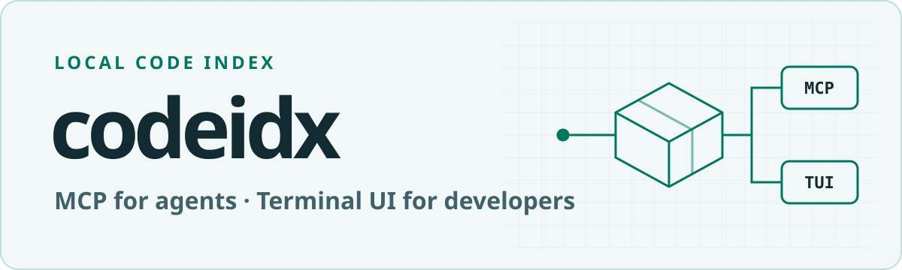

<a name="readme-top"></a>

<p align="center">
  <picture>
    <source media="(prefers-color-scheme: dark)" srcset=".github/assets/banner-dark.svg">
    <source media="(prefers-color-scheme: light)" srcset=".github/assets/banner-light.svg">
    
  </picture>
</p>

<h1 align="center">codeidx</h1>

<p align="center"><strong>给 AI 的代码索引 MCP，给开发者的原生终端界面。</strong></p>

<p align="center">
  <a href="#quick-start">快速开始</a> · <a href="#mcp">接入 MCP</a> · <a href="#terminal">终端界面</a> · <a href="#benchmark">实测数据</a> · <a href="#languages">语言支持</a>
</p>

## 在本地查代码

Codeidx 用 Rust 为项目建立索引。你可以找出跨文件的相关符号、读取实现片段，或借助本机语言服务器查询定义和引用。MCP 服务和终端界面使用同一套引擎，各自维护索引。

| 能力 | 用途 |
|---|---|
| **代码结构** | 用 RepoMap 看仓库里的关键符号，用文件大纲查看声明和行号 |
| **关键词和语义搜索** | 挂载后即可按关键词搜索。启用向量索引后可做语义搜索或混合排序 |
| **定义和引用** | 查询源码位置时按需启动本机语言服务器 |
| **按需索引** | 挂载时在内存中建索引，默认监听改动，卸载时释放项目索引 |

<a name="quick-start"></a>

## 快速开始

需要 [Rust stable](https://rustup.rs/) 与本机 C 编译、链接工具链。源码构建可能下载 ONNX Runtime。Windows 使用 Rust MSVC 工具链、C++ Build Tools 和 Windows SDK 10.0.19041 或更新版本。

```sh
git clone https://github.com/Thatgfsj/codeidx.git
cd codeidx
cargo build --locked --release --bin codeidx-mcp --bin codeidx-tui
```

可执行文件位于 `target/release/`，Windows 文件带 `.exe` 后缀。MCP 和终端界面运行时无需 Python 或 Node.js。语言服务器按需单独安装。

<a name="mcp"></a>

## 接入 MCP

在支持 stdio 的 MCP 客户端中添加以下配置。配置位置与键名以客户端文档为准。将 `command` 换成构建产物的绝对路径。Windows 的路径可写作 `C:/path/to/codeidx-mcp.exe`。

```json
{
  "mcpServers": {
    "codeidx": {
      "command": "/absolute/path/to/target/release/codeidx-mcp"
    }
  }
}
```

先用 `mount_project` 挂载项目的绝对路径。已挂载随仓示例项目后，给 `search_code` 传入下列参数即可查到示例函数。

```json
{"path":"/absolute/path/to/codeidx/tests/fixtures/sample-project","query":"unicorn_marker_fn","mode":"keyword","top_k":1}
```

这次查询的结果如下（节选）。

```text
@"src/lib.rs"
1	27-32	15.98	"unicorn_marker_fn"	"pub fn unicorn_marker_fn(cfg: &GoldConfig) -> String {…"
```

结果按文件分组，保留全局排名、行范围、分数和代码片段。正文位于 `content[0].text`，省略 `format` 时只返回 `compact` 正文。需要 JSON 或 Markdown 展示时，分别显式传 `format: "json"` 或 `format: "md"`。`tools/list` 一次返回全部 12 个工具。挂载后可直接调用任意查询工具。

<details>
<summary>工具一览</summary>

| 查询目标 | 工具 |
|---|---|
| 项目生命周期 | `mount_project`、`unmount_project`、`list_mounted_projects`、`sync_project` |
| 仓库与文件结构 | `get_repo_map`、`get_file_outline` |
| 找代码与读取实现 | `search_code`、`read_symbol` |
| 调用链与影响范围 | `trace_calls` |
| 定义、引用和类型信息 | `lsp_definition`、`lsp_references`、`lsp_hover` |

`path` 为项目根目录的绝对路径，`file_path` 为项目内相对路径。LSP 行号从 1 开始，列号使用 UTF-16 代码单元计数，从 0 开始。stdio 使用逐行 JSON-RPC，日志走 stderr。详见[架构与协议](ARCHITECTURE.md)。

</details>

`trace_calls` 以指定函数或自动入口生成调用树。`direction` 支持 `down`、`up` 和 `both`，用节点的文件、行和符号作为 `from` 可继续展开。`unique` 和 `same_file` 表示静态候选，不是语义确认；`✓` 表示本地 LSP 确认了项目内定义。接收者无法确定时不会仅凭同名方法强行连边。`⇢` 表示调用点未解析到项目内定义，可能是外部依赖或动态调用。缺少 LSP 时仍可查询静态结果；发生精化回退时会在摘要中标明。

<a name="terminal"></a>

## 终端界面

```sh
./target/release/codeidx-tui
```

Windows PowerShell 中运行 `.\target\release\codeidx-tui.exe`。输入项目路径并按 <kbd>Enter</kbd> 挂载。用 <kbd>F1</kbd> 至 <kbd>F5</kbd> 切换仓库概览、搜索、文件大纲、LSP 和项目列表。在搜索页输入关键词并按 <kbd>Enter</kbd>，再用方向键选中符号，按 <kbd>Enter</kbd> 查看源码。按 <kbd>F6</kbd> 打开调用链，使用方向键移动和展开或折叠，按 <kbd>Enter</kbd> 查看选中定义。按 <kbd>?</kbd> 查看按键。

在随仓示例项目中搜索 `unicorn_marker_fn`，得到以下结果（节选）。

```text
Search · keyword
Query: unicorn_marker_fn

File          Lines  Symbol
src/lib.rs    27–32  unicorn_marker_fn
src/main.rs    4–6   —
src/main.rs    7–12  main
```

<a name="benchmark"></a>

## 一个真实仓库的 Token 实测

在同一匿名仓库中关闭向量索引，单次挂载用时 **399 ms**，索引了 **187 个文件、4,821 个符号**。表中只统计 MCP 正文，以 `o200k_base` 实际分词。

| 场景 | 旧版 | 当前紧凑格式 | 本地去重原型 |
|---|---:|---:|---:|
| RepoMap，两版均返回 3,847 个符号 | 47,076 | **24,360（省 48.3%）** | — |
| 单文件大纲，两版均返回 47 个符号 | 923 | **723（省 21.7%）** | — |
| 7 次关键词搜索，共 160 条命中 | 8,312 | **7,572（省 8.9%）** | **7,231（再省 4.5%）** |

原型在单次查询内复用同一文件中完全相同的代码行，并逐条验证片段可原样还原。其中一次查询从 913 降至 777 tokens，再省 14.9%。用 `cl100k_base` 复核时，搜索去重也额外节省约 4.5%。收益随查询和仓库变化。更多性能数据见[验收记录](docs/acceptance-log.md)。

<a name="languages"></a>

## 语言与平台

Tree-sitter 支持 Rust、Python、TypeScript、JavaScript、Go、Java、C、C++、C#、Kotlin、Dart、PHP 和 HTML。HTML 索引带显式 `id` 的元素。PHP 索引常见声明与静态可识别引用。

LSP 根据本机 `PATH` 查找外部服务器。Rust、Python 和 Go 已做端到端验证。Linux 和 Windows MSVC 的 MCP 已通过原生运行检查。Windows 的交互式终端界面和 macOS 的运行验收仍待验证。构建细节见[兼容性说明](docs/COMPAT.md)。

## 开发与验证

```sh
cargo fmt --all --check
cargo clippy --locked --workspace --all-targets -- -D warnings
cargo test --locked --workspace
```

- [架构与协议](ARCHITECTURE.md)
- [验收步骤](docs/ACCEPTANCE.md)
- [问题反馈](https://github.com/Thatgfsj/codeidx/issues)

## 许可证

[GPL-3.0-or-later](LICENSE)

[↑ 回到顶部](#readme-top)
