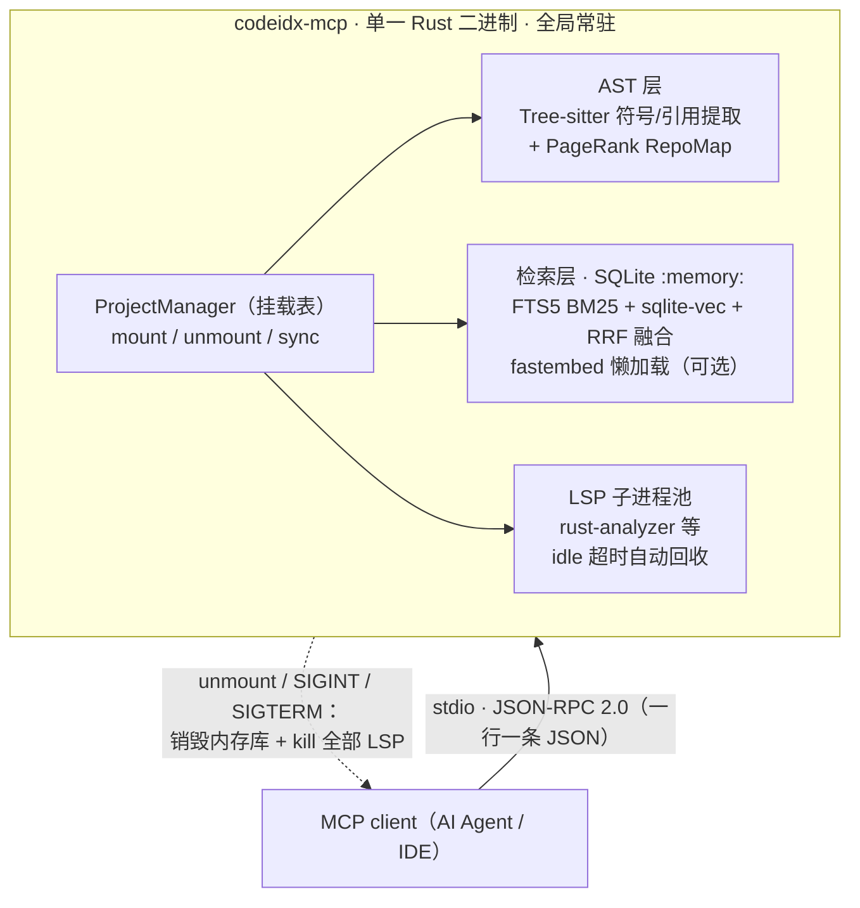

# codeidx-mcp

全局按需挂载的代码索引 MCP 服务 —— 单一 Rust 原生二进制，零 Python/Node 运行时依赖。

## 核心特性

- **全局轻量常驻**：启动时零扫描、零模型、零 LSP，内存占用 < 15MB
- **按需挂载**：仅当 AI 调用 `mount_project(path)` 时才在内存中初始化索引
- **纯内存态**：AST 符号表 / 依赖图 / FTS5 / 向量索引全部在 SQLite `:memory:`，不在项目目录残留缓存
- **三层能力**：
  1. AST 骨架（Tree-sitter + PageRank RepoMap）
  2. 混合检索（FTS5 BM25 + sqlite-vec 向量 + RRF 融合，fastembed 懒加载可选）
  3. 按需 LSP 桥（rust-analyzer 等，idle timeout 自动回收）
- **即时释放**：`unmount_project` 销毁内存库并 kill 关联 LSP；SIGINT/SIGTERM 优雅清理

## 文档

- 架构契约：[ARCHITECTURE.md](ARCHITECTURE.md)
- 验收线路：[docs/ACCEPTANCE.md](docs/ACCEPTANCE.md)
- 验收记录：[docs/acceptance-log.md](docs/acceptance-log.md)
- Agent 渐进式披露 SOP：[docs/AGENT-SOP.md](docs/AGENT-SOP.md)

## 安装与构建

前置：Rust 稳定版工具链（[rustup](https://rustup.rs/)）。

```bash
cargo build --release --bin codeidx-mcp
```

- 产物为单文件原生二进制 `target/release/codeidx-mcp`，运行期零 Python / Node.js 依赖。
- SQLite（bundled，FTS5 内嵌编译）与 sqlite-vec 均静态链接，不依赖系统库。
- 可选的向量检索 embedding 模型（fastembed，BAAI/bge-small-zh-v1.5）仅在首次以 `enable_vector=true` 挂载时懒加载，缓存命中后免联网。

## MCP 客户端接入（stdio JSON-RPC）

codeidx-mcp 走 stdio 上的 JSON-RPC 2.0，可被任意 MCP 客户端（AI Agent / IDE）作为 stdio server 挂起：

- **一行一条 JSON 消息**（不使用 LSP 式 `Content-Length` 头）
- **stdout 仅输出 JSON-RPC 协议字节**；一切日志 / tracing 走 stderr，客户端可放心把 stdout 逐行 `JSON.parse`
- 工具执行失败不走协议层错误：`tools/call` 返回 `result.isError = true` 与 `content[0].text = "error: <原因>"`（`-32601` 这类仅保留给 method not found 等协议级错误）
- 握手协议版本：`initialize` 宣告 `protocolVersion` = `2024-11-05`

通用 JSON-RPC over stdio 客户端配置片段：

```json
{
  "mcpServers": {
    "codeidx": {
      "command": "/absolute/path/to/target/release/codeidx-mcp",
      "args": [],
      "env": {
        "RUST_LOG": "info",
        "CODEIDX_LSP_IDLE_SECS": "300"
      }
    }
  }
}
```

服务端不读任何命令行参数，全部运行期开关通过环境变量注入（见[环境变量](#环境变量)）。

最小冒烟（一行一条 JSON，肉眼即可验证 stdout 纯净性）：

```bash
target/release/codeidx-mcp <<'EOF'
{"jsonrpc":"2.0","id":1,"method":"initialize","params":{"protocolVersion":"2024-11-05","capabilities":{},"clientInfo":{"name":"smoke","version":"0"}}}
{"jsonrpc":"2.0","method":"notifications/initialized"}
{"jsonrpc":"2.0","id":2,"method":"tools/list"}
EOF
```

`tools/list` 应返回 11 个工具。Agent 侧的调用纪律（渐进式披露）见 [docs/AGENT-SOP.md](docs/AGENT-SOP.md)。

## MCP 工具速查

11 个工具，参数名一律蛇形（snake_case）。除 `list_mounted_projects` 外，均要求 `path`（已挂载项目的根目录绝对路径）；`line` 一律 1-based、`character` 一律 0-based（UTF-16 code unit，与 LSP 对齐）。

| 工具 | 关键参数 | 一句话用途 |
|---|---|---|
| `mount_project` | `path`；`enable_vector?`（bool，默认 false） | 挂载项目并在内存中构建索引；其余工具仅对已挂载项目可用 |
| `unmount_project` | `path` | 卸载项目：销毁内存索引并回收关联的 LSP 子进程 |
| `list_mounted_projects` | — | 列出当前已挂载的项目及其索引规模 |
| `sync_project` | `path` | 增量同步，反映文件系统的增 / 改 / 删 |
| `get_repo_map` | `path`；`focus_files?`；`token_budget?`（默认 3000） | PageRank 加权的代码骨架图（纯文本，超预算截断） |
| `search_code` | `path`；`query`；`mode?`（hybrid/keyword/vector，默认 hybrid）；`top_k?`（默认 8） | 三模式代码检索；返回 `mode` 回显实际执行模式 |
| `get_file_outline` | `path`；`file_path` | 单个文件的符号大纲（无函数体） |
| `read_symbol` | `path`；`file_path`；`symbol_name` | 指定符号的完整实现代码 |
| `lsp_definition` | `path`；`file_path`；`line`；`character` | 跳转到指定位置的符号定义 |
| `lsp_references` | `path`；`file_path`；`line`；`character` | 列出指定位置符号的全部引用 |
| `lsp_hover` | `path`；`file_path`；`line`；`character` | 返回指定位置的 hover 信息 |

## 环境变量

| 变量 | 默认 | 作用 |
|---|---|---|
| `CODEIDX_LSP_IDLE_SECS` | 300 | LSP 子进程空闲回收秒数；超时未用的语言服务器自动 kill，下次调用再冷启动 |
| `CODEIDX_DISABLE_VECTOR` | 未设置 | 设为 `1` 强制纯 FTS5：vector / hybrid 请求一律降级 keyword，返回 `mode` 回显实际执行模式 |
| `RUST_LOG` | `info` | tracing 日志过滤（如 `codeidx=debug`）；日志全部写 stderr，绝不污染 stdout |

## 架构

三层能力、全部内存态、按需生命周期：



- **内存态**：挂载时才为项目创建 SQLite `:memory:` 库，AST 符号表、依赖图、FTS5 与向量索引全部驻留内存，项目目录不残留任何缓存文件。
- **按需生命周期**：启动零扫描、零模型、零 LSP；embedding 模型仅首次启用向量时懒加载（进程内单例复用）；LSP 子进程按需冷启动、idle 超时回收。
- Cargo workspace 组成与依赖方向见 [ARCHITECTURE.md](ARCHITECTURE.md) §2。

## 性能与资源（实测）

以下数字全部出自 [docs/acceptance-log.md](docs/acceptance-log.md) 的验收与探针实测记录（除注明 debug 外均为 release 二进制；向量相关为 fastembed BAAI/bge-small-zh-v1.5）：

- 空闲常驻：VmRSS 实测 **10.3MB**（门 15MB，`initialize` 后静置测量）
- 挂载后：**≈17.8MB**（release 实测，多语言 fixture，含全部 AST 索引 + FTS5，无向量；debug 构建约为 16.2MB）
- 向量模型懒加载后：常驻 VmRSS **+131.6MB**（release 探针值；debug 构建含索引开销为 +205MB）
- 挂载毫秒级：缓存命中下含向量全流程（模型 init + 6 文件索引 + ~20 chunk 嵌入）实测 **508ms**；首次无缓存需下载 90.5MB 模型约 86s（缓存目录 `~/.cache/codeidx-mcp`，约 91MB）
- 检索：真模型 vector / hybrid 单次实测 **5ms**
- 黑盒验收 release 全绿：bb_phase1 17/17 + bb_phase2 6/6 + bb_phase3 8/8；`cargo test` 121 passed / 0 failed / 1 ignored（真模型单测标记 ignored）
- 语义检索实证：中文查询"组合配置生成标记字符串的函数"在 vector / hybrid 双路命中目标函数（缓存命中免联网）

> `mount_project` 与 `search_code` 的返回体自带 `elapsed_ms` 字段，可在自己的环境里复测。

## License

GPL-3.0-or-later
